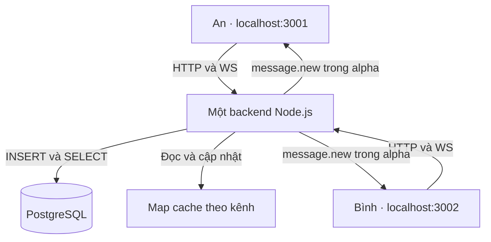

# Kiến trúc và giao thức — hai cổng, một backend

Bản **1.3.0** chạy một process Node.js, một ChatService, một Map cache theo kênh và một WebSocketServer. PostgreSQL giữ lịch sử bền vững.

| Thành phần | An | Bình |
| --- | --- | --- |
| Frontend | [localhost:3001/?user=An](http://localhost:3001/?user=An) | [localhost:3002/?user=Binh](http://localhost:3002/?user=Binh) |
| WebSocket | `ws://localhost:3001/ws?user=An&channel=C_alpha` | `ws://localhost:3002/ws?user=Binh&channel=C_alpha` |
| Kênh mặc định | C_alpha | C_alpha |
| Backend / DB / Map | Dùng chung | Dùng chung |

Trong Docker, hai cổng host 3001/3002 cùng được publish tới cổng 3000 trong app container. Khi chạy Node trực tiếp, `listenMany()` mở hai HTTP server cùng dùng Express app và upgrade handler; các socket được quản lý bởi cùng WebSocketServer. Đóng app sẽ đóng cả hai listener.



## Đọc lịch sử và gửi tin

1. Client GET lịch sử alpha trước khi mở WebSocket.
2. Cache chưa có kênh: SELECT PostgreSQL, đặt vào Map và ghi CACHE MISS. Đọc tiếp ghi CACHE HIT.
3. Client mở /ws; backend gắn socket với user và kênh.
4. Client tạo client_msg_id và gửi message.send.
5. Backend kiểm tra event, INSERT có tham số, cập nhật cache, rồi broadcast message.new tới mọi socket trong kênh, gồm người gửi.
6. Backend ACK người gửi. Gửi lại cùng ID của cùng user/kênh trả ACK bản ghi cũ, không broadcast thêm lần nữa.

Cổng truy cập không quyết định phòng chat. Socket An 3001 và socket Bình 3002 cùng alpha nhận tin của nhau.

## HTTP API

Các endpoint có trên **cả hai cổng**:

| Endpoint | Kết quả |
| --- | --- |
| GET /health | 200 và status ok nếu DB kết nối được; 503 khi DB lỗi |
| GET /api/channels | alpha và beta |
| GET /api/channels/alpha/messages | History alpha, trường cache, header X-Cache |
| GET /api/channels/alpha/messages?after=10 | Tin alpha có id > 10 |
| GET /api/channels/beta/messages | History beta |

Tên kênh dạng C_alpha cũng được chấp nhận. after phải là số nguyên an toàn, không âm. History có cấu trúc:

```json
{
  "channel": "C_alpha",
  "cache": "HIT",
  "messages": [
    {
      "id": 1,
      "channel": "C_alpha",
      "user": "An",
      "text": "Chào cả nhóm!",
      "client_msg_id": "c-demo-an-001",
      "created_at": "2025-10-06T04:00:00.000Z",
      "ts": "1759723200.000000"
    }
  ]
}
```

Thời gian/ID trên là minh họa; lúc chạy do PostgreSQL cung cấp.

## WebSocket event

| Chiều | Type | Trường chính |
| --- | --- | --- |
| Client → backend | message.send | channel, user, text, client_msg_id |
| Backend → kênh | message.new | channel, id, ts, user, text, client_msg_id, created_at |
| Backend → người gửi | message.ack | channel, client_msg_id, duplicate, message |
| Backend → client mới | connection.ready | channel, user |
| Backend → kênh | presence | channel, users là tên duy nhất |
| Backend → người gửi | error | code, message, client_msg_id khi xác định được |

User/kênh trên frame phải khớp kết nối. Text có 1–4000 ký tự sau trim; client_msg_id gồm chữ, số, _ và -, dài tối đa 128. SQL dùng parameter; frontend hiển thị textContent. Kiểm tra Origin/Host giữ kết nối cùng origin của từng trang; An và Bình không cần gọi API chéo cổng.

## Reconnect và nhất quán

Reconnect chờ 0,5; 1; 2; 4 rồi tối đa 5 giây. Ping/pong mỗi 15 giây phát hiện socket chết; sự kiện offline/online trong browser hỗ trợ phản ứng sớm.

Sau khi WS mở, client GET những tin sau cursor cuối. Frame đến khi GET chưa xong được đệm; sau đó history và buffer được gộp, loại trùng và sắp theo ID.

Tin chưa ACK được giữ trong RAM và thử gửi lại sau 5 giây với cùng ID. Unique constraint `(channel_id, user, client_msg_id)` ngăn tạo tin trùng. sessionStorage giữ bản nháp; hàng chờ ACK không được lưu bền vững qua F5.

Đọc/ghi mỗi kênh đi qua Promise queue để GET cũ không ghi đè cache có tin mới. Queue, socket và Map chỉ chia sẻ trong một process.

## DB, cache và cấu hình

Bảng messages lưu id, channel_id, user, text, client_msg_id, created_at và ts. ts là cột generated, epoch UTC của created_at với sáu chữ số phần lẻ. Dùng id làm cursor.

Map không có TTL và giữ toàn bộ lịch sử của kênh đã đọc. Restart app làm Map rỗng, dữ liệu DB vẫn còn. Khi reset thủ công, dừng app trước để dữ liệu DB và cache không lệch nhau.

| Cấu hình | Công dụng |
| --- | --- |
| DATABASE_URL | PostgreSQL connection string |
| PORTS=3001,3002 | Hai listener khi Node chạy trực tiếp |
| HOST=127.0.0.1 | Bind local của Node trực tiếp |
| APP_BIND_IP=127.0.0.1 | Địa chỉ publish hai cổng Docker trên host |
| PORT=3000 | Listener nội bộ của container app; PORTS được ưu tiên nếu có |
| DEMO_AN_URL / DEMO_BINH_URL | URL hiển thị trong log khởi động Docker, đúng cổng host |

Tên query là danh tính demo; gói chưa triển khai xác thực tài khoản, phân quyền thành viên hoặc nhiều backend process.

Tham khảo: [Node.js 24 HTTP](https://nodejs.org/docs/latest-v24.x/api/http.html), [ws](https://github.com/websockets/ws), [node-postgres queries](https://node-postgres.com/features/queries), [Docker port publishing](https://docs.docker.com/engine/network/port-publishing/).
